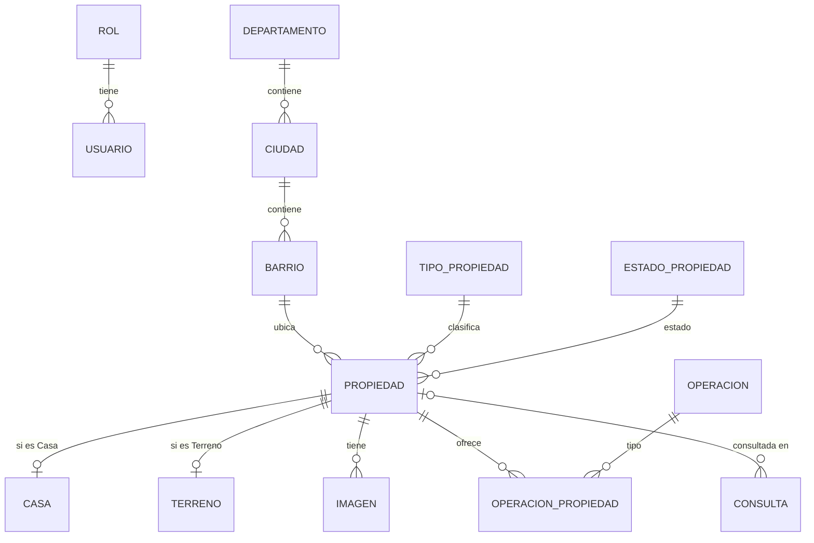

# Base de datos — S&N Inmobiliaria

PostgreSQL 16 + PostGIS 3.4. Los scripts se ejecutan automáticamente la primera vez
que se crea el contenedor (ver `docker/README.md`).

## Estructura

| Carpeta | Contenido |
|---|---|
| `schema/` | `01_extensiones` · `02_tablas` · `03_indices` · `04_triggers` |
| `seed/` | `01_catalogos` · `02_ubicacion` (desde los GeoJSON del frontend) · `03_propiedades_demo` (28 propiedades) · `04_admin_dev.sh` (administrador inicial) · `05_contenido_sitio` (contenido editable del sitio) |
| `pruebas/` | `verificar.sql`: comprueba los datos y que cada regla rechace lo inválido (todo con ROLLBACK) |

## Modelo entidad-relación

## Reglas garantizadas por la base

| Regla | Mecanismo |
|---|---|
| Un terreno solo puede tener operación Venta | Trigger `trg_operacion_propiedad_validar` |
| `casa` solo para tipo Casa, `terreno` solo para tipo Terreno | Triggers `trg_casa_validar`, `trg_terreno_validar` |
| Cambiar el tipo no puede dejar datos incoherentes | Trigger `trg_propiedad_cambio_tipo` |
| La ubicación debe estar dentro del barrio (`ST_Covers`) | Trigger `trg_propiedad_ubicacion` |
| Máximo una imagen principal por propiedad | Índice único parcial `uq_imagen_principal` |
| Email único sin distinguir mayúsculas | Índice único `uq_usuario_email_lower` |
| Precio > 0, moneda PYG/USD, código `prefijo-000`, hash BCrypt | Restricciones `CHECK` |

`propiedad.ubicacion` es una columna **generada** a partir de `latitud`/`longitud`:
PostgreSQL la recalcula sola y nunca queda desincronizada.

## Datos de demostración: supuestos a revisar

- Las 7 propiedades que el frontend clasificaba como "Departamento" se cargaron como **Casa**
  (prop-002, 004, 006, 007, 013, 014, 015); sus títulos todavía dicen "Departamento en …".
- El GeoJSON no tenía estos datos, por lo que se cargaron valores supuestos:
  `casa.sala/comedor/cocina = true` y `terreno.tiene_titulo = false`.
- Todos los precios están en USD, como en el frontend.
